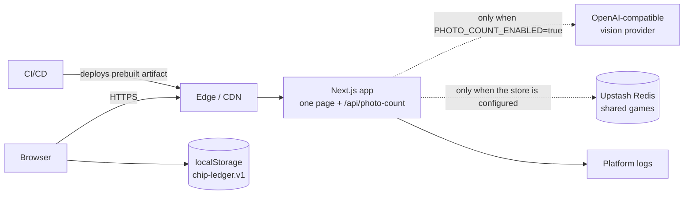
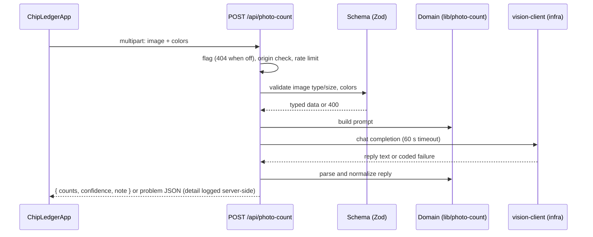

# Architecture

Chip Ledger is a single-page poker buy-in and cash-out tracker ([SPEC-0001](./specs/0001-chip-ledger/spec.md), [ADR-0004](./adr/0004-chip-ledger-client-architecture.md)). Keep this file consistent with the `standards.architecture` section of `sdd.yaml` — when they disagree, `sdd.yaml` wins and this file is the bug.

## 1. Goals

- **Correct and secure by default.** Boundaries and validation make the safe path the easy path.
- **Fast and accessible.** Server rendering, small bundles, semantic HTML.
- **Changeable.** Clear layers and tests let people and agents modify the system without fear.
- **Explainable.** Every significant decision has an ADR; every feature has a spec.

Non-goals: accounts, server-side storage of games, syncing across devices, and localization beyond English strings with locale-aware money formatting.

## 2. System context



A game lives in the browser's `localStorage` until the host shares it. Sharing copies it to a Redis store (Upstash, over `fetch`) behind `/api/games`, where devices read it by polling and editors send reducer actions that the server applies (SPEC-0003, [ADR-0005](./adr/0005-shared-live-games-architecture.md)). Without the store variables, sharing is off and the server stores nothing. The third-party services, the optional vision provider and the optional store, are recorded in `sdd.yaml` (`security.external-services`).

Shared-game code by layer: rules and schemas in `lib/shared-game.ts`; the store interface, adapters, key hashing, and shared rate limits in `lib/infra/`; the handlers in `app/api/games/` (shared steps in `_lib.ts`).

## 3. Layers and boundaries

| Layer  | Default location                                  | Responsibility                                                                                                         | May import        | Must not import        |
| ------ | ------------------------------------------------- | ---------------------------------------------------------------------------------------------------------------------- | ----------------- | ---------------------- |
| UI     | `app/components`                                  | Presentational components: props in, events out                                                                        | domain            | api, infra, routes     |
| Routes | `app/` (except `components/`, `api/`), `proxy.ts` | Pages, layout, framework files; `ChipLedgerApp` owns state and wires infra to UI                                       | ui, domain, infra | api                    |
| API    | `app/api`                                         | Validate input, guard, delegate, shape responses                                                                       | domain, infra     | ui                     |
| Domain | `lib`                                             | Game rules, settlement, schemas, formatting, prompt                                                                    | —                 | ui, api, routes, infra |
| Infra  | `lib/infra`                                       | Browser storage, clipboard, photo-count client, vision provider, rate limiter, env; the only layer that reads env vars | domain            | ui, api, routes        |

Rules (CONSTITUTION-04 to -07):

1. Dependencies point inward: UI and routes depend on domain; domain depends on nothing.
2. UI does no I/O and reads no secrets.
3. API routes validate input, authorize, call domain/infra, and map results to responses. They contain no business rules.
4. A new layer needs an ADR and an `sdd.yaml` update.
5. Boundaries are enforced by `no-restricted-imports` in `eslint.config.mjs`, mirroring `sdd.yaml`. Imports use the `@/` alias; relative parent imports are rejected so the rules cannot be bypassed.

## 4. Request flow

Game changes never leave the browser: a screen emits an action, `ChipLedgerApp` runs it through the pure `gameReducer`, and `lib/infra/game-storage` saves the result.

The one server request, photo counting, only exists when `PHOTO_COUNT_ENABLED=true`:



## 5. Data and contracts

- Every boundary has a schema (request, response, config, content frontmatter). Types are inferred from schemas.
- Schemas live next to the domain logic they describe and are shared with tests.
- Breaking contract changes need a spec, a migration plan, and an ADR if the contract is public.
- A player's money in is `buyins × buyIn + moved`, where `moved` is the net money chip sales have moved to them (default 0, so older saves and shared games open unchanged). The sum of `moved` over the players is always zero, so the pot does not change when chips are sold ([SPEC-0004](./specs/0004-chip-sales-between-players/spec.md), [ADR-0006](./adr/0006-chip-sales-as-a-per-player-net-amount.md)).

## 6. Cross-cutting concerns

| Concern        | Where it lives                           | Reference                               |
| -------------- | ---------------------------------------- | --------------------------------------- |
| Error handling | central logging helper, error boundaries | [Error Handling](./ERROR_HANDLING.md)   |
| Security       | middleware, headers config, validation   | [Security Policy](./SECURITY_POLICY.md) |
| Config         | validated env module                     | [Configuration](./CONFIGURATION.md)     |
| Observability  | logger, tracing, error tracker           | [Observability](./OBSERVABILITY.md)     |
| Accessibility  | components, tokens, tests                | [Accessibility](./ACCESSIBILITY.md)     |
| SEO            | single metadata module                   | [SEO Guide](./SEO_GUIDE.md)             |

## 7. Directory map (default)

```text
app/                    Routes layer: page, layout, error/not-found, robots, sitemap
  ChipLedgerApp.tsx     Client container: game state, persistence, photo and clipboard wiring
  components/           Presentational screens and shared components
  api/photo-count/      The one route handler (off by default)
  globals.css           Tailwind entry, base styles, chip artwork
lib/                    Domain: game, reducer, settlement, summaries, money, photo-count, seo
  infra/                Adapters: storage, clipboard, photo-count client, vision client, rate limit, env
proxy.ts                Per-request CSP nonce
styles/tokens.css       Design tokens (Tailwind theme)
test/
  unit/                 Domain, infra, route, component, and container tests (Vitest)
  e2e/                  User flows, headers, SEO (Playwright)
  visual/               Every step × theme × width (Playwright screenshots)
  a11y/                 Axe audits in both themes
docs/                   Governance, standards, ADRs, specs, component docs
scripts/                Repo automation (checks, audits, init)
.github/                CI, templates, ownership, dependency automation
```

## 8. Decision trees

**Where do I add a page?** Create the route under `app/`, load data through a domain helper, set metadata via `lib/seo.ts`, add an e2e test, and add the path to `INDEXABLE_PATHS`.

**Where does this logic go?** If it has no React or I/O: `lib/`. If it needs a datastore or external API: `lib/infra`, called from a route or server component. If it only shapes pixels: `app/components`.

**Do I need to update `sdd.yaml`?** Yes when you add a layer, change a boundary, add an external service, change CI gates or coverage thresholds, or add a new class of dependency. Otherwise no.

**Do I need a spec? An ADR?** See the change tiers in [SDD Guide §3](./SDD_GUIDE.md).

**What tests do I add?** Pure logic: unit. Component behavior: component test with role queries. A user flow: e2e. Visual change: visual test. New interaction pattern: a11y check.

## 9. Build and delivery

1. Developer opens a PR from a short-lived branch.
2. CI runs governance checks, lint, typecheck, unit tests with coverage, build, e2e, a11y, CodeQL, Lighthouse.
3. A preview deployment is created per PR.
4. After review and green checks, the PR merges to `main`.
5. CI builds the production artifact and deploys it. See [Deployment](./DEPLOYMENT.md) and [Release Process](./RELEASE_PROCESS.md).

## 10. Performance

- Server-render by default; hydrate only what is interactive.
- Budgets live in `sdd.yaml` and `lighthouserc.json`.
- Optimize images, fonts, and third-party scripts; avoid layout shift.

## 11. Related

[Constitution](./CONSTITUTION.md) · [SDD Guide](./SDD_GUIDE.md) · [Engineering Standards](./ENGINEERING_STANDARDS.md) · [ADR index](./adr/README.md)
