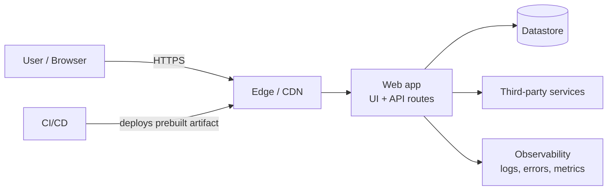
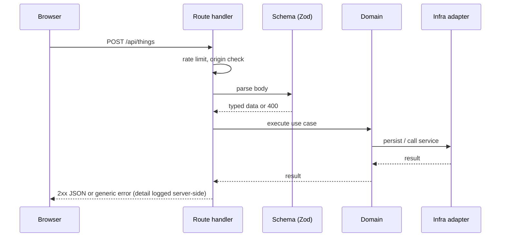

# Architecture

> **Template note:** this document ships with a sensible default for a server-rendered web app (Next.js App Router, TypeScript). Replace the diagrams, layer names, and directory map with your own. Keep it consistent with the `standards.architecture` section of `sdd.yaml` — when they disagree, `sdd.yaml` wins and this file is the bug.

## 1. Goals

- **Correct and secure by default.** Boundaries and validation make the safe path the easy path.
- **Fast and accessible.** Server rendering, small bundles, semantic HTML.
- **Changeable.** Clear layers and tests let people and agents modify the system without fear.
- **Explainable.** Every significant decision has an ADR; every feature has a spec.

Non-goals: _list what this system deliberately does not try to do._

## 2. System context



Replace with your actual containers and external systems. Name every third-party service and record what data it receives in `sdd.yaml` (`security.external-services`).

## 3. Layers and boundaries

| Layer  | Default location     | Responsibility                                           | May import      | Must not import |
| ------ | -------------------- | -------------------------------------------------------- | --------------- | --------------- |
| UI     | `app/components`     | Presentational components, layout, interaction           | domain          | api, infra      |
| Routes | `app/**/page`, `app/api` | Wire requests to domain; validate input; shape responses | domain, infra   | ui internals    |
| Domain | `lib`                | Pure business and content logic, schemas, formatting     | —               | ui, api, infra  |
| Infra  | `lib/infra`          | Adapters for datastore, email, queues, external APIs; the only layer that reads secrets | domain | ui |

Rules (CONSTITUTION-04 to -07):

1. Dependencies point inward: UI and routes depend on domain; domain depends on nothing.
2. UI does no I/O and reads no secrets.
3. API routes validate input, authorize, call domain/infra, and map results to responses. They contain no business rules.
4. A new layer needs an ADR and an `sdd.yaml` update.
5. Boundaries are enforced by lint (`no-restricted-imports` or `eslint-plugin-boundaries`), mirroring `sdd.yaml`.

## 4. Request flow



## 5. Data and contracts

- Every boundary has a schema (request, response, config, content frontmatter). Types are inferred from schemas.
- Schemas live next to the domain logic they describe and are shared with tests.
- Breaking contract changes need a spec, a migration plan, and an ADR if the contract is public.

## 6. Cross-cutting concerns

| Concern        | Where it lives                       | Reference                                   |
| -------------- | ------------------------------------ | ------------------------------------------- |
| Error handling | central logging helper, error boundaries | [Error Handling](./ERROR_HANDLING.md)    |
| Security       | middleware, headers config, validation | [Security Policy](./SECURITY_POLICY.md)    |
| Config         | validated env module                 | [Configuration](./CONFIGURATION.md)         |
| Observability  | logger, tracing, error tracker       | [Observability](./OBSERVABILITY.md)         |
| Accessibility  | components, tokens, tests            | [Accessibility](./ACCESSIBILITY.md)         |
| SEO            | single metadata module               | [SEO Guide](./SEO_GUIDE.md)                 |

## 7. Directory map (default)

```text
app/                    Routes, layouts, and UI
  components/           Shared presentational components
  api/                  Route handlers (validate → delegate → respond)
lib/                    Domain logic, schemas, helpers (no React)
  infra/                External adapters; only place that reads secrets
content/                Markdown/JSON content, schema-validated at load
styles/                 Tokens and global styles
public/                 Static assets
test/
  unit/                 Domain and component tests
  e2e/                  Critical user flows
  visual/               Visual regression
  a11y/                 Axe audits
docs/                   Governance, standards, ADRs, specs, component docs
scripts/                Repo automation (checks, audits, init)
.github/                CI, templates, ownership, dependency automation
```

## 8. Decision trees

**Where do I add a page?** Create the route under `app/`, load data through a domain helper, set metadata via the metadata module, add an e2e test, and add the path to the sitemap source.

**Where does this logic go?** If it has no React or I/O: `lib/`. If it needs a datastore or external API: `lib/infra`, called from a route or server component. If it only shapes pixels: `app/components`.

**Do I need to update `sdd.yaml`?** Yes when you add a layer, change a boundary, add an external service, change CI gates or coverage thresholds, or add a new class of dependency. Otherwise no.

**Do I need a spec? An ADR?** See the change tiers in [SDD Guide §3](./SDD_GUIDE.md).

**What tests do I add?** Pure logic: unit. Component behavior: component test with role queries. A user flow: e2e. Visual change: visual test. New interaction pattern: a11y check.

## 9. Build and delivery

1. Developer opens a PR from a short-lived branch.
2. CI runs governance checks, lint, typecheck, unit tests with coverage, build, e2e, a11y, CodeQL, Lighthouse.
3. A preview deployment is created per PR.
4. After review and green checks, the PR merges to `main`.
5. CI builds the production artifact and deploys it. See [Deployment](./DEPLOYMENT.md) and [Release Process](./RELEASE_PROCESS.md).

## 10. Performance

- Server-render by default; hydrate only what is interactive.
- Budgets live in `sdd.yaml` and `lighthouserc.json`.
- Optimize images, fonts, and third-party scripts; avoid layout shift.

## 11. Related

[Constitution](./CONSTITUTION.md) · [SDD Guide](./SDD_GUIDE.md) · [Engineering Standards](./ENGINEERING_STANDARDS.md) · [ADR index](./adr/README.md)
