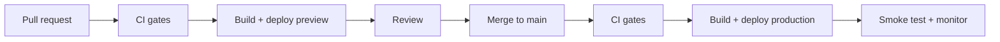

# Deployment

How code gets from `main` to production, repeatably. If a step is manual, it is documented here.

> **Template note:** Vercel is the default target because it pairs well with Next.js. The pattern — build in CI, deploy the prebuilt artifact, preview per PR, scripted rollback — carries to any host.

## 1. Strategy

- **CI-driven deploys.** Build in GitHub Actions and deploy the prebuilt artifact, so every quality gate runs before anything ships. Disable the platform's auto-deploy-on-push so a commit cannot bypass CI.
- **Preview per PR.** Each PR gets an isolated preview URL; the link is posted on the PR.
- **Promotion = merge.** Merging to `main` deploys to production.
- **Environments:** `development` (local), `preview` (per PR), `production`.

## 2. Pipeline



Workflow responsibilities (`.github/workflows/`):

| Workflow                | Trigger        | Does                                                   |
| ----------------------- | -------------- | ------------------------------------------------------ |
| `ci.yml`                | PR, push       | Governance checks, lint, typecheck, tests, build, e2e, a11y |
| `deploy.yml`            | PR, push `main`| Pull platform settings, build, deploy preview/production. Skipped until `DEPLOY_PROJECT_ID` is set |
| `codeql.yml`            | PR, weekly     | Static security analysis                               |
| `security-audit.yml`    | Manifest change, weekly | Dependency audit, opens an issue on scheduled failures |
| `release-drafter.yml`   | push `main`    | Drafts release notes from PR labels                    |

Skip builds for changes that cannot affect the artifact (docs-only, tests-only) using path filters or the platform's ignored-build-step.

## 3. Required secrets and variables

Set in GitHub: **Settings → Secrets and variables → Actions**.

| Name                      | Kind     | Purpose                                  |
| ------------------------- | -------- | ---------------------------------------- |
| `DEPLOY_TOKEN`            | Secret   | Platform API token (scoped to this project) |
| `DEPLOY_ORG_ID`           | Variable | Platform organization/team ID            |
| `DEPLOY_PROJECT_ID`       | Variable | Platform project ID                      |

Runtime application variables are set on the platform per environment. See [Configuration](./CONFIGURATION.md).

## 4. Branch protection (set manually; not stored in git)

On `main`:

- [ ] Require a pull request and at least one approving review
- [ ] Require review from code owners
- [ ] Require status checks listed in `sdd.yaml` (`devex.ci.required-checks`), with branches up to date
- [ ] Restrict force pushes and deletions; do not allow bypass for admins
- [ ] Require linear history or squash merging
- [ ] Enable secret scanning and push protection, Dependabot alerts, and code scanning (the `codeql` check needs it; private repositories need GitHub Code Security)

## 5. Local build

```bash
pnpm install --frozen-lockfile
pnpm build
pnpm start   # serve the production build locally
```

## 6. Manual redeploy

Use only when automation is unavailable.

1. **Re-run the workflow:** Actions → _Deploy_ → _Run workflow_ on `main`.
2. **Empty commit:** `git commit --allow-empty -m "chore: redeploy"` via a PR (never push to `main` directly).
3. **CLI:** `vercel pull && vercel build --prod && vercel deploy --prebuilt --prod` with a scoped token.

## 7. Rollback

Roll back first, diagnose second.

1. Promote the previous good deployment (platform dashboard or CLI: `vercel rollback`).
2. Confirm error rate and key flows recovered.
3. Open a revert PR if the cause is a code change, or fix forward if the cause is configuration.
4. Write the incident up (timeline, cause, action items).

Database or data migrations must be backward compatible for one release so a rollback is safe. Prefer expand → migrate → contract.

## 8. Post-deploy verification

- [ ] Smoke test the home page and one critical flow
- [ ] Error tracker shows no new spike for the release
- [ ] Web Vitals and Lighthouse budgets hold
- [ ] Release notes drafted; version tag applied (see [Release Process](./RELEASE_PROCESS.md))

## 9. Troubleshooting

| Symptom                                   | Likely cause and fix                                                        |
| ----------------------------------------- | --------------------------------------------------------------------------- |
| Platform builds every commit on its own   | Auto-deploy still enabled. Disable "Git integration" deploys for this project |
| Workflow cannot pull platform settings    | Wrong token scope or project/org IDs. Re-issue the token; check variables   |
| Preview missing on a PR                   | Path filter skipped the build, or the job failed. Check the workflow run    |
| Build fails only in CI                    | Missing environment variable or version drift. Match `.nvmrc`; check [Configuration](./CONFIGURATION.md) |
| Works in preview, fails in production     | Environment-specific variable missing in production scope                   |

## Related

[Release Process](./RELEASE_PROCESS.md) · [Configuration](./CONFIGURATION.md) · [Observability](./OBSERVABILITY.md) · [Security Practices](./SECURITY_POLICY.md)
