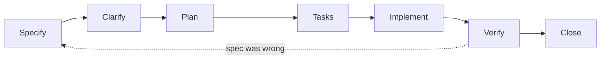

# Spec-Driven Development (SDD) Guide

How this repository turns intent into shipped software. Specs are the source of truth; code and tests implement them; changes to behavior start as changes to a spec.

## 1. The artifacts

| Artifact       | Location                | Answers                                  | Changes via                                  |
| -------------- | ----------------------- | ---------------------------------------- | -------------------------------------------- |
| Constitution   | `docs/CONSTITUTION.md`  | What must always be true?                | Amendment process (ADR + owner approval)     |
| System SDD     | `sdd.yaml`              | How is the system shaped and gated?      | PR + ADR for structural changes              |
| ADRs           | `docs/adr/`             | Why did we choose this?                  | New ADR; old ones are superseded, not edited |
| Feature specs  | `docs/specs/NNNN-slug/` | What should this feature do, and how?    | Spec PR before or with the code              |
| Reference docs | `docs/*.md`             | How do we build, test, secure, and ship? | Normal PR, updated with the behavior         |
| Code + tests   | repo                    | What does the system actually do?        | Normal PR                                    |

Precedence runs top to bottom (see the Constitution). When a lower artifact disagrees with a higher one, the lower one is the bug.

## 2. Lifecycle



| Phase     | Output                                     | Exit gate                                                        |
| --------- | ------------------------------------------ | ---------------------------------------------------------------- |
| Specify   | `spec.md`: problem, stories, requirements  | Every requirement has an ID and an acceptance criterion          |
| Clarify   | Resolved open questions                    | Zero `[NEEDS CLARIFICATION]` markers remain                      |
| Plan      | `plan.md`: design, layers, risks           | Plan passes the Constitution check; ADR written if architectural |
| Tasks     | `tasks.md`: ordered, testable steps        | Each task is small, has a done-condition, and names its tests    |
| Implement | Code + tests + docs, in small commits      | Each task's done-condition holds                                 |
| Verify    | CI green, acceptance criteria demonstrated | Evidence attached to the PR (test output, screenshot, trace)     |
| Close     | Spec status set to `implemented`           | Docs and `sdd.yaml` updated; follow-ups filed as issues          |

Do not start **Plan** with open clarifications, and do not start **Implement** until the plan is reviewed (Tier 2: by a human; Tier 1: by the author).

## 3. Change tiers

Pick the lightest tier that is honest about the risk.

| Tier | Examples                                                                           | Required artifacts                                     |
| ---- | ---------------------------------------------------------------------------------- | ------------------------------------------------------ |
| 0    | Typo or copy fix, patch-level dependency bump, refactor with no behavior change    | PR only (tests still must pass)                        |
| 1    | New feature, behavior change, bug fix with user-visible effect                     | Short feature spec + tests that cite requirement IDs   |
| 2    | New layer, new class of dependency, auth or security model, data model, public API | Spec + plan + ADR + `sdd.yaml` update + human approval |

If unsure, go one tier up. A bug fix is Tier 1 when it changes documented behavior; the regression test cites the requirement it restores.

## 4. Writing a good spec

Start from `docs/specs/_template/spec.md`. A spec is good when someone who was not in the room can implement and verify it.

- **Problem first.** State who is affected and why it matters before describing a solution.
- **Requirements have IDs.** Format `REQ-<spec number>-<nn>`, for example `REQ-0007-03`. One testable statement each, using MUST / SHOULD / MAY.
- **Acceptance criteria are executable.** Given / When / Then, concrete values, no adjectives like "fast" or "intuitive".
- **Non-goals are explicit.** What this spec deliberately does not do.
- **Cross-cutting sections are mandatory.** Accessibility, security, privacy, performance, error states, and (if adopted) i18n. Write `N/A: <reason>`; never delete the heading.
- **Unknowns are marked, not guessed.** Use `[NEEDS CLARIFICATION: question]`. Planning is blocked until they are resolved.
- **Describe behavior, not code.** File names and function signatures belong in the plan.

Minimal excerpt:

```markdown
### Requirements

- REQ-0007-01: The signup form MUST reject an email that fails schema validation and show an inline, announced error.
- REQ-0007-02: The server MUST rate-limit signup attempts to 5 per minute per client.

### Acceptance criteria

- AC-0007-01 (REQ-0007-01): Given an empty or malformed email, when the user submits, then the field shows "Enter a valid email" and receives focus.
```

## 5. Traceability

Traceability is cheap and catches drift early.

- Tests cite the requirement they verify in the test name or a comment: `it("REQ-0007-01: rejects malformed email", …)`.
- PR descriptions link the spec (and ADR, if any).
- `sdd.yaml` maps every Constitution invariant to enforcement (`constitution.enforcement`); `scripts/check-sdd-refs.mjs` fails CI when the map is incomplete or points at files that do not exist.
- Specs record their status in a header table: `draft` → `approved` → `implemented` → `superseded`.

## 6. Working with AI agents

AI agents are first-class contributors under the same rules.

1. Load context in order: Constitution → `sdd.yaml` → the relevant spec → reference docs. `AGENTS.md` lists the exact read order.
2. Use the slash commands in `.claude/commands/` (`/new-spec`, `/new-adr`, `/review-pr`) or follow the same steps by hand.
3. The agent proposes the spec and plan; a human approves them before implementation for Tier 2 work.
4. If implementation reveals the spec is wrong, the agent **stops and updates the spec** (with a note in the PR), rather than letting the code silently diverge.
5. The agent reports using the handoff format in `docs/AI_AGENT_GUIDE.md`: what shipped, what is pending, known risks, with evidence.

## 7. Keeping specs alive

- When a PR merges, set the spec status to `implemented` and update the index in `docs/specs/README.md`.
- Bug fixes and follow-ups amend the affected spec's requirements and acceptance criteria in the same PR.
- A replaced spec is marked `superseded` with a link to its successor; it is never deleted.
- Reference docs describe the system as it is. Specs describe a change and its intent. When a spec ships, fold the lasting parts into the reference docs.

## 8. Anti-patterns

- Writing the spec after the code and calling it documentation.
- Specs that restate the implementation line by line.
- "TBD" or vague requirements that cannot fail a test.
- Using Tier 0 to avoid a spec for a real behavior change.
- Treating `sdd.yaml` as a wiki page instead of a checked contract.
- Editing an accepted ADR to rewrite history instead of superseding it.

## 9. Adopting this in a new project

See [`TEMPLATE_SETUP.md`](../TEMPLATE_SETUP.md) for the first-run checklist, then read [`docs/README.md`](./README.md) for the full document map.
