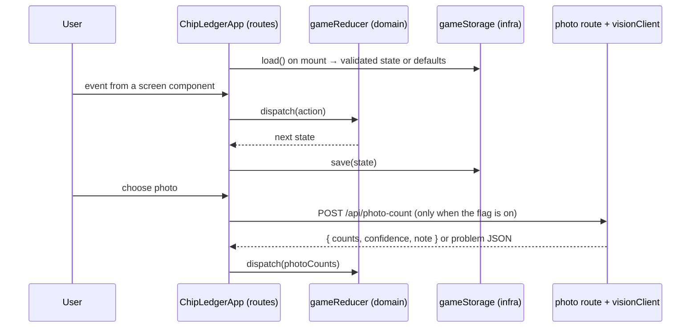

# Plan: SPEC-0001 Chip Ledger

| Field  | Value                                                             |
| ------ | ----------------------------------------------------------------- |
| Spec   | [spec.md](./spec.md)                                              |
| ADR    | [ADR-0004](../../adr/0004-chip-ledger-client-architecture.md)     |
| Status | implemented                                                           |

## 1. Approach

Port the prototype onto the stack in `sdd.yaml` (Next.js App Router, TypeScript strict, Tailwind, Zod, Vitest, Testing Library, Playwright, axe). The game is a pure reducer plus selectors in `lib/`; adapters in `lib/infra/`; one flagged API route for photo counting (`app/api/photo-count`, off by default); presentational screens in `app/components/`; one client container in `app/` that owns state and wires adapters to screens. Design values move into tokens (`styles/tokens.css`) mapped into the Tailwind theme. Rationale and alternatives: ADR-0004.

## 2. Constitution check

| Invariant group           | Complies? | Notes                                                                                     |
| ------------------------- | --------- | ----------------------------------------------------------------------------------------- |
| Governance (01–03, 16–18) | Yes       | Spec, plan, ADR in the same PR; `sdd.yaml` and docs updated; PR from a feature branch      |
| Architecture (04–07)      | Yes       | Layers enforced by `no-restricted-imports`; UI does no I/O; domain is React-free and tested; routes layer added via ADR-0004 |
| Security (08–11)          | Yes       | Zod at both boundaries (storage, photo reply); headers + nonce CSP; central logger; generic messages |
| Quality (12–15)           | Yes       | WCAG 2.1 AA with axe in both themes; coverage thresholds unchanged; Lighthouse budgets unchanged |

## 3. Design

- **Layers touched:** domain (`lib`), infra (`lib/infra`), ui (`app/components`), routes (`app`, new in `sdd.yaml`).
- **Files and modules (new):**
  - `lib/chips.ts` — chip palette (ids, labels).
  - `lib/game.ts` — Zod schema for saved state, types, `createGame`, selectors (stack value, rate, pot, cash-out).
  - `lib/game-reducer.ts` — actions and pure reducer.
  - `lib/settlement.ts` — nets, scaling, residue, payments.
  - `lib/money.ts` — currency formatting, decimal and count parsing.
  - `lib/results-text.ts` — copyable summary.
  - `lib/photo-count.ts` — request schema, prompt, reply schema, error-code messages, status text.
  - `lib/setup-summary.ts`, `lib/count-check.ts` — the summary/notice logic shown under Setup and Cash out.
  - `lib/error-logging.ts` — `logError`, `logWarning`.
  - `lib/seo.ts` — site metadata, page metadata, indexable paths.
  - `lib/api-problem.ts` — RFC 9457-style error body.
  - `lib/infra/game-storage.ts`, `lib/infra/clipboard.ts`, `lib/infra/photo-count-client.ts` (browser → our route), `lib/infra/vision-client.ts` (server → OpenAI-compatible API), `lib/infra/rate-limit.ts`, `lib/infra/env.ts`.
  - `app/api/photo-count/route.ts` — 404 when off; origin → rate limit → validate → domain → infra → respond.
  - `app/layout.tsx`, `app/page.tsx`, `app/ChipLedgerApp.tsx`, `app/error.tsx`, `app/global-error.tsx`, `app/not-found.tsx`, `app/robots.ts`, `app/sitemap.ts`, `app/globals.css`.
  - `app/components/*` — `StepsNav`, `Chip`, `ChipStackArt`, `ActionBar`, `Notice`, `SetupScreen`, `ChipRow`, `TableScreen`, `CashOutScreen`, `PlayerCashCard`, `CountCheck`, `SettleScreen`, `VisuallyHidden`.
  - `styles/tokens.css`; `proxy.ts` (CSP nonce); `next.config.mjs` (headers).
  - Tooling: `package.json`, `pnpm-lock.yaml`, `tsconfig.json`, `eslint.config.mjs`, `prettier.config.mjs`, `postcss.config.mjs`, `vitest.config.ts`, `playwright.config.ts`.
- **Data model and contracts:** `GameState` (Zod) — `{ screen, count, buyIn, currency, scale, players[6]: { id, name, buyins, counts: Record<chipId, int> }, chips: { id, color, count, value }[] }`, identical to the prototype's JSON. Photo reply (Zod) — `{ counts: Record<color, number>, confidence?: string, note?: string }`.
- **Control flow:**

## 4. Testing strategy

| Requirement           | Unit                          | Component                 | E2E | Visual | A11y |
| --------------------- | ----------------------------- | ------------------------- | --- | ------ | ---- |
| REQ-0001-01, -02      | reducer `go`                  | StepsNav                  | ✓   | ✓      | ✓    |
| REQ-0001-03 … -07     | reducer, setup summary, money | SetupScreen, ChipRow      | ✓   | ✓      | ✓    |
| REQ-0001-08, -09      | reducer, selectors            | TableScreen               | ✓   | ✓      | ✓    |
| REQ-0001-10 … -12     | parsing, selectors, count check | CashOutScreen, CountCheck | ✓ | ✓      | ✓    |
| REQ-0001-13 … -17     | schemas, prompt, messages, adapters, route handler | PlayerCashCard, container | ✓ (hidden when off) |  | ✓ |
| REQ-0001-18 … -21     | settlement                    | SettleScreen              | ✓   | ✓      | ✓    |
| REQ-0001-22 … -24     | results text, reducer         | SettleScreen              | ✓   |        |      |
| REQ-0001-25, -26      | storage adapter, schema       |                           | ✓   |        |      |
| REQ-0001-27           |                               |                           |     | ✓      | ✓    |

The container's photo, clipboard, and storage wiring is covered by a component test with the adapters mocked at the infra boundary. Security headers are asserted in e2e.

## 5. Risks and mitigations

| Risk                                                 | Likelihood | Impact | Mitigation                                                                  |
| ---------------------------------------------------- | ---------- | ------ | --------------------------------------------------------------------------- |
| Visual drift from the prototype during the Tailwind port | Medium  | Medium | Side-by-side screenshots of prototype and app per step, both themes, both widths |
| Visual baselines differ between macOS and CI Linux   | High       | Low    | Generate baselines from the CI run (Linux) and commit them                   |
| CSP blocks Next.js scripts                           | Medium     | High   | Nonce via `proxy.ts`; e2e loads every step with the production build         |
| Saved games from the prototype in another origin     | Low        | Low    | Same key and shape; origins differ so no migration is needed                 |
| Photo route enabled before abuse controls exist      | Low        | High   | Off by default; §7 of the spec lists the preconditions; enabling is a reviewed change |

## 6. Rollout and rollback

Direct release; no data migration. Roll back by reverting the PR. Storage key is unchanged, so a revert does not lose saved games.

## 7. Documentation to update

- [x] Reference docs: Architecture, Configuration, Design System, Security Policy, Testing (conventions), README, CONTRIBUTING
- [x] `sdd.yaml` (stack markers, layers incl. routes, external services, headers, name/description)
- [x] `.env.example` and `docs/CONFIGURATION.md` (`NEXT_PUBLIC_SITE_URL`, `PHOTO_COUNT_*`)
- [x] Component docs in `docs/components/` for reusable components
