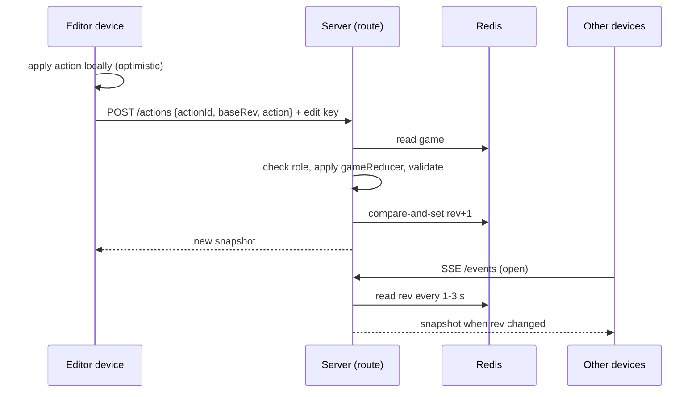

# Plan: SPEC-0003 Shared live games

| Field  | Value                                                                   |
| ------ | ----------------------------------------------------------------------- |
| Spec   | [spec.md](./spec.md)                                                    |
| ADR    | [ADR-0005](../../adr/0005-shared-live-games-architecture.md) (accepted) |
| Status | approved (owner, 2026-10-30)                                            |

## 1. Approach

A game stays on the device until the host presses **Share**. Sharing copies the game to a Redis store (Upstash, reached over `fetch`) and gives back two secrets: a **watch key** and an **edit key**. The QR code and link carry one of them after the `#`, so the page request never sends it to our server. The client sends it as a bearer token on every call; the server stores only its hash.

The pure reducer from SPEC-0001 is the engine. A client sends a small **action** (the same kinds the reducer already has). The server loads the game, checks the caller may edit, applies `gameReducer`, validates the result with the game schema, and saves it only if nobody saved in between (compare-and-set on a revision number, with a few retries). Every other device learns about the new revision through **Server-Sent Events**, with plain polling as the fallback. Because actions are small and mostly independent, edits to different fields merge, buy-in changes add up, and the last write wins on the same field (REQ-0003-11). The full decision and the alternatives are in [ADR-0005](../../adr/0005-shared-live-games-architecture.md).

Two changes to the shared data follow from the spec:

- The current step (`screen`) leaves the shared game and becomes per-device state, so nobody's screen is pulled around (REQ-0003-15). The shared game gains a `started` flag instead.
- "New game, same players" and "Start over" create a new game rather than change the shared one (REQ-0003-16). This amends `newGameSamePlayers` and the reset flow for shared games only; solo games behave as today.

Sharing switches itself off when the store is not configured: the **Share** button is not rendered and the API answers 404. Local development and tests use an in-memory store with the same interface.

## 2. Constitution check

| Invariant group           | Complies? | Notes                                                                                                                                                                                                       |
| ------------------------- | --------- | ----------------------------------------------------------------------------------------------------------------------------------------------------------------------------------------------------------- |
| Governance (01–03, 16–18) | Yes       | Spec and ADR first. `sdd.yaml`, ARCHITECTURE, SECURITY_POLICY, CONFIGURATION and `.env.example` change in the implementation PRs. Human approval is required (CONSTITUTION-17): auth model and stored data. |
| Architecture (04–07)      | Yes       | No new layer: the work fits `lib` (domain), `lib/infra`, `app/api`, `app/components` and the routes layer. A new cross-cutting mechanism (a realtime store) is covered by ADR-0005 (CONSTITUTION-07).       |
| Security (08–11)          | Yes       | Nothing is weakened. New controls are listed in §3. The CSP keeps `connect-src 'self'` (same-origin SSE and fetch); no header relaxes.                                                                      |
| Quality (12–15)           | Yes       | Tests per requirement (§4). Accessibility is part of the design. Solo page weight is unchanged: sharing code loads only when used.                                                                          |

One existing rule needs a note, not an exception: `sdd.yaml` prohibits "shared mutable state across requests or routes". Game state lives in the external store and every handler is stateless, so the rule holds. The rate limiter moves from per-instance memory to the store for the new routes.

## 3. Design

### Layers touched

| Layer                | New or changed                                                                                                                                                                                                                                                              |
| -------------------- | --------------------------------------------------------------------------------------------------------------------------------------------------------------------------------------------------------------------------------------------------------------------------- |
| domain `lib/`        | `shared-game.ts` (schemas, roles, allowed actions, apply-and-validate, edit-code rules, lifecycle), `game.ts` (split `screen` out), `game-reducer.ts` (`startGame`), `share-announcements.ts`                                                                               |
| infra `lib/infra/`   | `game-store.ts` (interface, Upstash REST adapter, in-memory adapter), `secrets.ts` (key and code generation, hashing), `shared-game-client.ts` (fetch, SSE, offline queue), `joined-games-storage.ts` (local list of games), `env.ts` (store config), `store-rate-limit.ts` |
| api `app/api/games/` | Route handlers listed below                                                                                                                                                                                                                                                 |
| ui `app/components/` | `ShareSheet`, `QrCode`, `GamesList`, `ConnectionStatus`, `WatchOnlyNotice`, `ArchivedNotice`, `GameUnavailable`                                                                                                                                                             |
| routes `app/`        | `app/g/[id]/page.tsx` (join page, `noindex`), `ChipLedgerApp.tsx` (shared-game hook, per-device step), `app/robots.ts` (disallow `/g/`)                                                                                                                                     |

### Data model

- **SharedGame** (Zod, in `lib/shared-game.ts`): `{ id, rev, createdAt, updatedAt, started, game }`, where `game` is the existing game state without `screen`. Stored together with `{ watchKeyHash, editKeyHash, code?: { hash, salt, expiresAt }, recentActionIds }` which never leave the server.
- **Roles:** `watch` or `edit`, decided by which key hash the bearer token matches. The comparison is constant-time.
- **Keys:** 128 random bits from `crypto.getRandomValues`, base64url. Hashed with SHA-256 (no salt needed at this entropy).
- **Edit code:** 6 characters from `ABCDEFGHJKMNPQRSTUVWXYZ23456789`. Stored as a salted SHA-256 with an expiry 10 minutes out. Showing a new code replaces the old.
- **Actions a client may send** (`SharedActionSchema`, a discriminated union): every `GameAction` except `go`, `replace` and `newGameSamePlayers`, plus `startGame`. Each carries an `actionId` (UUID) for idempotency; the server remembers the last 50.
- **Limits:** request body 8 KB, game size 32 KB, names 200 characters (existing).

### Routes

| Method and path                | Auth  | What it does                                                                                                                              |
| ------------------------------ | ----- | ----------------------------------------------------------------------------------------------------------------------------------------- |
| `POST /api/games`              | none  | Create from the local game; returns `id`, `watchKey`, `editKey`. Rate-limited per client.                                                 |
| `GET /api/games/{id}`          | key   | Snapshot `{ rev, started, game, role, archived, online }`. Used on join and as the polling fallback.                                      |
| `GET /api/games/{id}/events`   | key   | SSE stream: sends the snapshot when `rev` changes, a heartbeat every 15 s, closes at ~55 s so the client reconnects with `Last-Event-ID`. |
| `POST /api/games/{id}/actions` | edit  | `{ actionId, baseRev, action }`. Applies and saves; answers the new snapshot.                                                             |
| `POST /api/games/{id}/code`    | edit  | Creates a new edit code and returns it with its expiry.                                                                                   |
| `POST /api/games/{id}/upgrade` | watch | `{ code }`. On a match returns the edit key. Wrong tries are counted per game.                                                            |
| `DELETE /api/games/{id}`       | edit  | Deletes the game for everyone.                                                                                                            |

Every handler follows [API Patterns](../../API_PATTERNS.md): request ID, same-origin check, store-backed rate limit, key check, Zod parse, domain call, generic error, server-side log. An unknown id, a deleted game and a wrong key all give the same 404 (REQ-0003-26).

### Store keys and lifecycle

- Every key is prefixed with the deployment environment, as `{env}:` where `env` is `VERCEL_ENV` (`production` or `preview`), so Preview and Production share one database without sharing data. The code issues only single-key and prefixed commands and never a bulk delete.
- `game:{id}` holds the game document; `seen:{id}` holds the last heartbeat time; `online:{id}` is a sorted set of connection ids scored by time (online count = members from the last 45 s).
- Every write and every heartbeat refreshes the TTL of `game:{id}` and `seen:{id}` to 24 h + 30 d. Lifecycle is computed on read: `archived` when `max(updatedAt, seen) + 24 h < now`. The TTL deletes the record 30 days later, so no scheduled job is needed (REQ-0003-19 to -21).
- Compare-and-set uses one small Lua script through the store's REST `EVAL`: write only if `rev` equals the value that was read.

### Control flow: an edit

### Client behaviour

- A `useSharedGame` hook in the routes layer owns the connection, the pending-action queue and the status (Live, Reconnecting, Offline). Presentational components get props only.
- The client keeps the actions the server has not confirmed and re-applies them on top of each new snapshot, so the screen never jumps back. On reconnect it sends the queue in order (REQ-0003-14). Replayed actions that no longer apply are dropped by the reducer's own guards; a replayed "set" can still overwrite a newer value, and that is the accepted risk in §5.
- Incoming snapshots do not replace a field that has focus: `DraftInput` keeps the draft until blur, then takes the server value (REQ-0003-12).
- Announcements: remote changes are turned into short sentences by a pure function, grouped within 1.5 s, and passed to the existing `LiveAnnouncer` (REQ-0003-29). Local actions are not echoed.
- Polling fallback: 3 s while the tab is visible, none while hidden; one fetch on becoming visible.

### Share sheet

A dialog opened from the app header on every step. Contents in order: heading, QR code (inline SVG, drawn from the encoder's module matrix), link text with **Copy link**, **Share** when `navigator.share` exists, the retention notice on first use, then the **Watch only | Can edit** radio group last. The edit code block ("Show edit code") sits under the group for editors. Built from the shared `Surfaces`, `Button`, `ConfirmInline` and tokens from SPEC-0002; no one-off sizes.

## 4. Testing strategy

| Requirement        | Unit                                                        | Component                                  | E2E (two or three browser contexts)               | Visual                     | A11y                      |
| ------------------ | ----------------------------------------------------------- | ------------------------------------------ | ------------------------------------------------- | -------------------------- | ------------------------- |
| REQ-0003-01, -27   | share-gating on store config                                | Share hidden when off                      | solo game sends no `/api/games` request           |                            |                           |
| REQ-0003-02, -03   |                                                             | ShareSheet: content, default, switch swaps | open sheet, switch, QR changes                    | sheet, both themes, 320 px | axe, keyboard walkthrough |
| REQ-0003-04, -05   | key generation, hash compare                                | join hook strips the hash                  | scan-equivalent link opens; `location.hash` empty |                            |                           |
| REQ-0003-06, -07   | role check per action                                       | watch-only controls                        | forged edit as watcher rejected                   | watch-only state           | axe                       |
| REQ-0003-08, -09   | code alphabet, expiry, replacement, lockout                 | upgrade form                               | upgrade by code; old and expired codes fail       |                            | axe                       |
| REQ-0003-10 to -12 | apply, CAS retry, additive buy-ins, idempotency             | draft not overwritten                      | two editors press + together; propagation time    |                            |                           |
| REQ-0003-13, -14   | queue and replay order                                      | ConnectionStatus states                    | network cut and restore                           | status states              | axe, announcement         |
| REQ-0003-15        | `startGame`, per-device step                                | waiting state                              | watcher waits then follows start                  |                            |                           |
| REQ-0003-16 to -18 | fork copy, joined-games list                                | GamesList                                  | new game leaves old game unchanged                | list                       | axe                       |
| REQ-0003-19 to -22 | lifecycle with fake clock, retention notice                 | ArchivedNotice                             | archived and expired links (clock hook)           | archived state             | axe                       |
| REQ-0003-23 to -26 | schemas, size caps, hashed storage, rate limits, 404 parity | GameUnavailable                            | wrong key and deleted game look the same          |                            | axe                       |
| REQ-0003-28 to -30 | announcement sentences, grouping                            | focus trap, Esc, QR text alternative       | keyboard-only share and join                      | forced colors, 200% zoom   | axe on every new state    |

Route tests run the real handlers against the in-memory store. A shared contract test runs against both the in-memory and the Upstash adapters; the Upstash run is a separate manual or scheduled job that needs credentials, not part of `pnpm verify`. E2E uses Playwright with several browser contexts against the in-memory store started by `pnpm dev` when no store is configured. Coverage thresholds in `sdd.yaml` apply to every new module.

## 5. Risks and mitigations

| Risk                                                                                                                    | Likelihood | Impact | Mitigation                                                                                                                                                                                                            |
| ----------------------------------------------------------------------------------------------------------------------- | ---------- | ------ | --------------------------------------------------------------------------------------------------------------------------------------------------------------------------------------------------------------------- |
| Long-lived SSE requests use too much function time or CPU on Vercel (earlier sessions on this repo hit CPU-time limits) | Medium     | High   | A spike (T-03) measures duration and CPU for 10 connected devices before the rest is built. Fallback: polling only, which the client already supports.                                                                |
| Redis command volume grows with connected devices (one check per device every 1–3 s)                                    | Medium     | Medium | Adaptive interval (1 s after a change, 3 s idle), one batched read per tick, a budget alert on the Upstash plan, and a per-game cap of 12 connections. Check the plan's current limits before relying on a free tier. |
| Replayed offline edits overwrite newer values from other devices                                                        | Medium     | Medium | Notice while waiting; each action carries `baseRev` and the server rejects a replay older than 15 minutes; buy-in changes are deltas and never overwrite.                                                             |
| Previews hold the production token, so a bug in a preview could touch production games                                  | Low        | High   | Keys are prefixed by `VERCEL_ENV`; no bulk-delete commands in the code; Preview variables scoped to feature branches; move previews to a second database if usage or risk grows.                                      |
| A link or code leaks (screenshot, chat)                                                                                 | Medium     | Medium | Watch-only is the default; codes expire in 10 minutes; keys are never logged; `Referrer-Policy` and `noindex` are in place. Any editor can delete the game. Revocation is a non-goal (Q3).                            |
| Code guessing                                                                                                           | Low        | High   | About 30 bits, 10-minute life, 5 wrong tries then a 1-minute lockout per game, store-backed so it holds across instances.                                                                                             |
| Storage abuse by creating many games                                                                                    | Medium     | Medium | Create limit per client, 32 KB size cap, short TTL, a global daily creation cap as a circuit breaker (disables sharing and logs).                                                                                     |
| Splitting `screen` out of the game breaks saved games                                                                   | Low        | Medium | The saved-game schema still reads old data (a missing or extra `screen` is accepted); a unit test loads a `chip-ledger.v1` fixture. Solo storage keeps its key and shape.                                             |
| Merge friction with other work on `ChipLedgerApp.tsx`                                                                   | Medium     | Low    | The shared-game logic lives in a hook and new files; `ChipLedgerApp.tsx` changes stay small. Rebase before each push.                                                                                                 |

### Redis command budget

The database is on a free Upstash plan limited to 500,000 commands a month (confirmed by the owner on 2026-10-30), with no budget alert set yet. Every step follows these rules:

- **Tests and CI never touch Redis.** Unit and end-to-end tests use the in-memory store (`GAME_STORE_MEMORY`); CI has no credentials. The only real-Redis runs are the manual store contract test (about 40 commands) and the T-03 spike, both bounded below.
- **Preview deployments** hold credentials only for the feature branch, and nothing calls Redis until a person opens a shared game.
- **Polling is the main cost, so it adapts:** the server checks a small revision key every 2 s for 60 s after a change, then every 5 s while the game is quiet. Clients stop when the tab is hidden and make one request when it is visible again. A game accepts at most 12 connections.
- **Heartbeats** go out every 20 s, not on every check, and each is one script call.
- **Edits** cost about 4 commands each (read, compare-and-set, revision key, and the answer).
- **Rough size of a game night** (estimate, replaced by the measured numbers from T-03): 10 devices for 4 hours, mostly quiet, is about 30,000 to 70,000 commands. Against 500,000 a month that is roughly 7 to 16 nights, so the budget is real but workable. The spike (about 2,500 commands, 0.5% of a month) must stay a small fraction of it.
- **When the limit is hit,** the store answers with an error; routes turn it into a generic 503 and the client keeps its local game running. A host never loses a game because Redis is out of quota. Sharing comes back by itself when the quota resets.
- **Alerts:** a budget alert in the Upstash console at 50% and 80% of the monthly limit, set by the owner.

## 6. Rollout and rollback

**Provisioning (owner, once).** See the numbered steps in the hand-off message and in `docs/CONFIGURATION.md` once written: create one Upstash Redis database through the Vercel Marketplace (the free plan allows one), connect it to Production, add its two REST variables to Preview by hand scoped to the feature branch, and confirm the variable names. Done on 2026-10-30; the names are `KV_REST_API_URL` and `KV_REST_API_TOKEN`.

**Release.** Direct release behind configuration: until the store variables exist, nothing changes for anyone. Order of PRs: (1) the domain and store with tests, no UI; (2) API routes; (3) join page and watch-only; (4) editing, sync and the offline queue; (5) Share sheet and QR; (6) games list and lifecycle; (7) docs, `sdd.yaml` and close. Each PR keeps `pnpm verify` green and ships behind the missing-configuration switch.

**Detecting trouble.** Server logs with request IDs for every rejected call; a Vercel usage alert on function duration; an Upstash alert on commands.

**Rollback.** Remove the store variables from Production: the Share button disappears, the API answers 404, and solo play is untouched. Existing shared games become unreachable and expire. To revert code, revert the PR; solo storage is unchanged.

## 7. Documentation to update

- [ ] Reference docs: `ARCHITECTURE.md` (sharing flow, store), `SECURITY_POLICY.md` (key and code model, retention), `API_PATTERNS.md` (SSE note), `ERROR_HANDLING.md`, `ACCESSIBILITY.md` (sheet, status, remote announcements), `DESIGN_SYSTEM.md` (new patterns)
- [ ] `sdd.yaml`: `security.external-services` (Upstash), a note on stateless handlers, coverage paths if needed
- [ ] ADR-0004: add "Superseded in part by ADR-0005" to its status line
- [ ] `.env.example` and `docs/CONFIGURATION.md`: store variables and the in-memory fallback
- [ ] Component docs in `docs/components/`: `ShareSheet`, `QrCode`, `GamesList`, `ConnectionStatus`
- [ ] `docs/specs/0001-chip-ledger/spec.md` and `docs/specs/0002-a11y-ux-polish/spec.md`: pointers from REQ-0001-24 and REQ-0002-11, -12 to REQ-0003-16
- [ ] `docs/ROADMAP.md`: nothing to remove (this was not a roadmap item)
