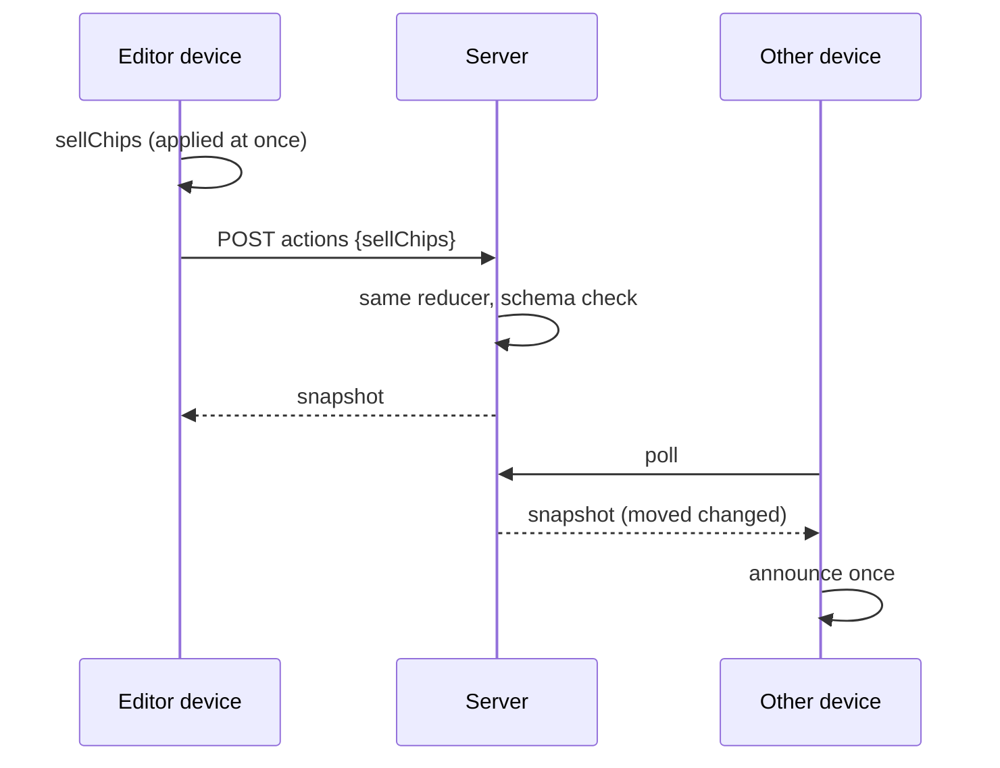

# Plan: SPEC-0004 Money in per player, and chip sales between players

| Field  | Value                                                               |
| ------ | ------------------------------------------------------------------- |
| Spec   | [spec.md](./spec.md)                                                |
| ADR    | [ADR-0006](../../adr/0006-chip-sales-as-a-per-player-net-amount.md) |
| Status | approved                                                            |

## 1. Approach

Each player gets one new optional number, `moved`: the net money that chip sales have moved to them (a buyer's `moved` goes up, a seller's goes down, and it may be negative). A sale of X by Ana to Ben does `Ana.moved -= X` and `Ben.moved += X`, so the pot is unchanged because the amounts cancel. Money in is `buyins × buyIn + moved`. Settle reads money in instead of `buyins × buyIn`. Nothing else in the maths changes: chips in play, the chip rate and the cash-out values depend on the buy-in count and buy-in, not on who holds the money.

One action, `sellChips { sellerId, buyerId, amount }`, in the solo reducer and the shared-game allowlist. The shared server applies it with the same reducer (ADR-0005), so the client and server agree. The table shows the amount first, the buy-in count small, and a small "incl. +5.00 from chip sales" line when `moved` is not zero. "Sell chips" opens an inline form (seller, buyer, amount) in the existing style. Alternatives (a list of sales, free editing of amounts, replacing buy-in counts with amounts) are weighed in the ADR.

## 2. Constitution check

| Invariant group           | Complies? | Notes                                                                                     |
| ------------------------- | --------- | ----------------------------------------------------------------------------------------- |
| Governance (01–03, 16–18) | Yes       | Spec, plan and ADR first; owner approval before code; tests cite REQ ids.                 |
| Architecture (04–07)      | Yes       | Rules in `lib/` (one reducer, used by client and server); UI in components; no new I/O.   |
| Security (08–11)          | Yes       | New action goes through the allowlist and its Zod schema; generic errors; no new secrets. |
| Quality (12–15)           | Yes       | Unit, component, e2e, a11y and visual tests; coverage thresholds hold.                    |

## 3. Design

- **Layers touched:** domain `lib/` (`game.ts`, `game-reducer.ts`, `settlement.ts`, `shared-game.ts`, `shared-game-queue.ts`, `announcements.ts`); UI `app/components/` (`TableScreen`, a new `SellChips` form, `SettleScreen` note); routes `app/` (`SharedGameApp`, the solo app wiring). No API route change.
- **Files and modules:**
  - `lib/game.ts`: `PlayerSchema` gains `moved: AmountSchema.default(0)`; `moneyIn(game, player)`; `pot` becomes the sum of money in.
  - `lib/game-reducer.ts`: `sellChips` action; `setPlayerCount` refuses when a dropped player has `moved ≠ 0`; `newGameSamePlayers` clears `moved`.
  - `lib/settlement.ts`: `putIn: moneyIn(game, player)`; the result says whether any sale was included.
  - `lib/shared-game.ts`: `SharedActionSchema` gains `sellChips` (`.strict()`, seller ≠ buyer, amount > 0); `SharedGameBodySchema` carries `moved` through `PlayerSchema`.
  - `lib/shared-game-queue.ts`: `coalesceKey` for `sellChips` is `null` (every sale counts).
  - `lib/announcements.ts`: `remoteChanges` also names players whose `moved` changed.
  - `app/components/SellChips.tsx` (new), `TableScreen.tsx`, `SettleScreen.tsx`, `docs/components/`.
- **Data model and contracts:** `Player.moved` (optional on input, default 0, so old saves and old shared games parse). Stored shared games are parsed with the same schema, so they gain `moved: 0` on first write. No API shape change beyond one more allowed action.
- **Control flow:** form submit → `dispatch({type:"sellChips",…})` → (solo) reducer; (shared) optimistic edit queued and sent as an `adjust`-style action; the server applies the same reducer and returns the new snapshot.

## 4. Testing strategy

| Requirement           | Unit                                     | Component                      | E2E                  | Visual      | A11y        |
| --------------------- | ---------------------------------------- | ------------------------------ | -------------------- | ----------- | ----------- |
| REQ-0004-01, -07      | `moneyIn`, pot                           | TableScreen rows               | table view           | table, both | axe table   |
| REQ-0004-02, -03, -04 | reducer `sellChips`, negative result     | SellChips form                 | solo sale            |             | axe form    |
| REQ-0004-05           | settlement with `moved`, "Includes" flag | SettleScreen note              | settle after sale    | settle      |             |
| REQ-0004-06           | pot after buy-in step                    |                                |                      |             |             |
| REQ-0004-08, -09      | allowlist schema, queue, `remoteChanges` | SharedGameApp editor / watcher | two devices          |             | axe watcher |
| REQ-0004-10           | old save and old shared body parse       |                                | reload saved game    |             |             |
| REQ-0004-12           | schema rejects same player, NaN, ≤ 0     |                                | server rejects (API) |             |             |
| REQ-0004-13           | reducer refusal, new game clears `moved` | message shown                  |                      |             |             |

## 5. Risks and mitigations

| Risk                                 | Likelihood | Impact | Mitigation                                                                                                                        |
| ------------------------------------ | ---------- | ------ | --------------------------------------------------------------------------------------------------------------------------------- |
| Pot and money in drift apart         | Low        | High   | One `moneyIn` used by table, pot and settle; test that the sum of `moved` over players is 0 after any sale.                       |
| Hidden players keep a `moved` amount | Medium     | Medium | Refuse lowering the count (REQ-0004-13); test it.                                                                                 |
| An old tab meets a game with `moved` | Low        | Low    | The old schema ignores the field, so the old tab shows buy-in-based amounts until it reloads; the server keeps the correct value. |
| A mistaken sale cannot be removed    | Medium     | Low    | Documented: record the reverse sale; the net line disappears at zero.                                                             |
| Rounding of money (cents)            | Low        | Medium | Amounts go through the existing money helpers; tests with .01 and large values.                                                   |

## 6. Rollout and rollback

Direct release in one PR after approval; no flag. The change is additive, so old saves and old shared games open unchanged. Rollback is a revert of the PR. `PlayerSchema` is not strict, so the older code would ignore `moved` when it loads a game: games in progress would lose their sale amounts (the pot and buy-in counts stay correct). That is acceptable for a revert, and it is noted here so nobody is surprised. Detect trouble by the sum of `moved` over the active players: it must be zero, and a unit test and a shared-server check keep it so.

## 7. Documentation to update

- [ ] Reference docs: `docs/ARCHITECTURE.md` (data model), `docs/ACCESSIBILITY.md` (sale form), `docs/ERROR_HANDLING.md` (refusals)
- [ ] `sdd.yaml` (nothing structural; check the spec/ADR indexes)
- [ ] `.env.example` and `docs/CONFIGURATION.md`: none
- [ ] Component docs in `docs/components/`: `SellChips.md`, `TableScreen.md`, `SettleScreen.md`
