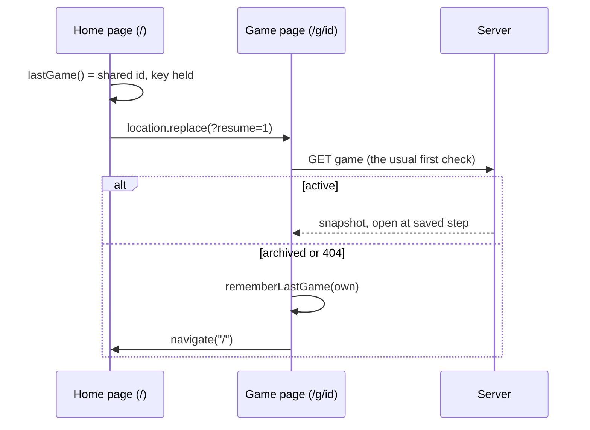

# Plan: SPEC-0006 Shared games that stay shared

| Field  | Value                |
| ------ | -------------------- |
| Spec   | [spec.md](./spec.md) |
| ADR    | none (Tier 1)        |
| Status | draft                |

## 1. Approach

Four small changes, each fixing one diagnosed cause, plus tests that pin the rule that every device stays in an active game.

1. **Remember the last game, and reopen it from `/`.** A new device-only record says which game this device used last: its own game, or a shared game by id. The record is written whenever a game page opens. When `/` loads and the record points at a shared game that this device still holds a key for, the solo app replaces the location with `/g/<id>?resume=1` before rendering any step. The shared page handles the fallbacks: if the game is archived or unavailable and it was opened with `resume=1`, it records "own game" and goes back to `/`. So the home page itself never asks the server anything (REQ-0006-03), and "is it still active?" is answered by the request the shared page already makes. Choosing the device's own game from **Games** records "own game" first (REQ-0006-04).
2. **Clear the copy once it is shared.** After **Create the link** succeeds, the solo app saves a fresh game (`createGame(randomId)`) to its own storage and records the new shared game as last used, then navigates. The players and counts are already in the shared game. One sentence is added to the notice shown before the first share (REQ-0006-06).
3. **Read limits that fit one table on one network.** The per-instance read limiter is keyed by address and game id (`<ip>:<gameId>`, the id from the path, not secret), limit 400 a minute, plus a second per-address limiter across all games, limit 1,200 a minute. Neither uses the store, so store commands don't change. The 429 keeps its `Retry-After`, which the client now reads: `fetchGame` returns `{ kind: "busy", retryAfterMs }`, and `useSharedGame` keeps a "not before" time that the next check, the visibility handler and the `online` handler all respect (REQ-0006-10). A refusal for being too frequent counts toward Reconnecting but never Offline (REQ-0006-11). Each refusal logs one warning with the route and the limit's name only (REQ-0006-12).
4. **Wording.** `statusText` reads "N phones live" ("1 phone live"), and the status row adds a short muted line: "Phones that are locked or in another app aren't counted." (REQ-0006-13, -14).

12 phones checking every 2 s make 360 reads a minute, so 400 leaves room for opening the page and heartbeats. 1,200 across games allows about three such tables behind one address (a venue, or mobile carrier NAT) and still caps one address reading many games.

## 2. Constitution check

| Invariant group           | Complies? | Notes                                                                                                                                                       |
| ------------------------- | --------- | ----------------------------------------------------------------------------------------------------------------------------------------------------------- |
| Governance (01–03, 16–18) | Yes       | Spec approved by the owner before code; tests cite REQ-0006 ids; the rate-limit change was approved as part of the spec (ask-first in `sdd.yaml`).          |
| Architecture (04–07)      | Yes       | Storage in `lib/infra/`, pure wording and timing in `lib/`, wiring in the route components. No new layer, no new dependency.                                |
| Security (08–11)          | Yes       | Limits are re-keyed and raised for one game, still capped per address; same 404 for unknown and wrong keys; logs hold no address, key or id. CSP unchanged. |
| Quality (12–15)           | Yes       | Unit, component, e2e and a11y tests; status row checked in both themes at 320 px.                                                                           |

## 3. Design

- **Layers touched:** `lib/` (sync wording and timing), `lib/infra/` (last-game record, client, limiter use), `app/api/games/` (read limits), `app/` (solo and shared apps, Share and Games controls), `app/components/` (status row, Share sheet text).
- **Files and modules:**
  - New `lib/infra/last-game-storage.ts`: `rememberLastGame({ kind: "own" } | { kind: "shared"; id })`, `lastGame()`. Zod-parsed, key `chip-ledger.last.v1`, try/catch with logging like the other storage modules.
  - `app/ChipLedgerApp.tsx`: in the hydrate effect, read `lastGame()`; if it is shared and `keyFor(id)` exists, `location.replace("/g/<id>?resume=1")` and render nothing further; otherwise record "own". Passes an `onShared` callback to `ShareControl`.
  - `app/ShareControl.tsx`: after `created`, call `onShared(outcome.id)` before `navigate`.
  - `app/SharedGameApp.tsx`: record "shared" on open; read and strip `resume=1`; on `unavailable` or `archived` with `resume`, record "own" and `navigate("/")`.
  - `app/GamesControl.tsx`: `onOpenOwn` and the leave/delete paths record "own" before navigating.
  - `app/api/games/_lib.ts`: two limiters; `readAllowed(request, gameId)` returns which limit refused, if any; refusal is logged.
  - `app/api/games/[id]/route.ts`: pass the id (after `GameIdSchema` parsing, so junk ids share one bucket).
  - `lib/infra/shared-game-client.ts`: parse `Retry-After` (seconds, clamped 1–300) into `retryAfterMs`.
  - `app/useSharedGame.ts`: `notBefore` timestamp; `schedule` and `resume` use `max(delay, notBefore - now)`; busy failures cap status at Reconnecting.
  - `lib/shared-game-sync.ts`: `statusText` wording; `connectionStatus(failures, { busy })`.
  - `app/components/ConnectionStatus.tsx`: the note line. `lib/share-links.ts`: notice sentence.
- **Data model and contracts:** one new localStorage record, `{ kind: "own" } | { kind: "shared", id: GameId }`. No API shape change. The 429 body and `Retry-After` are unchanged; the client starts reading the header.
- **Control flow:**

## 4. Testing strategy

| Requirement           | Unit                                                     | Component                                    | E2E                                       | Visual      | A11y             |
| --------------------- | -------------------------------------------------------- | -------------------------------------------- | ----------------------------------------- | ----------- | ---------------- |
| REQ-0006-01, -04      | last-game storage parse/round trip                       | ChipLedgerApp redirects; GamesControl own    | AC-0006-01, -02                           |             |                  |
| REQ-0006-02           |                                                          | SharedGameApp resume fallback (404/archived) | AC-0006-03                                |             |                  |
| REQ-0006-03           |                                                          | no fetch on `/` with own game                | AC-0006-04 (offline, request log)         |             |                  |
| REQ-0006-05, -06, -07 | notice text                                              | ShareControl calls `onShared`                | AC-0006-05, -06                           | share intro | axe Share sheet  |
| REQ-0006-08, -09      | limiter keys and limits                                  | route: 12×30/min pass; per-address cap       | AC-0006-07, -08 (route-level, same IP)    |             |                  |
| REQ-0006-10, -11      | client parses `Retry-After`; `connectionStatus` busy cap | hook: no check before `notBefore`            | AC-0006-09 (mocked 429)                   |             |                  |
| REQ-0006-12           | log call has route and limit only                        |                                              |                                           |             |                  |
| REQ-0006-13, -14      | `statusText` singular/plural                             | ConnectionStatus note                        |                                           | status row  | axe, both themes |
| REQ-0006-15           |                                                          | hook keeps game through busy/offline/hidden  | AC-0006-12 (two browsers, offline toggle) |             |                  |

AC-0006-07 runs against the route with an in-memory store and a fixed `x-forwarded-for`, not by launching 12 browsers.

## 5. Risks and mitigations

| Risk                                                               | Likelihood | Impact | Mitigation                                                                                                                  |
| ------------------------------------------------------------------ | ---------- | ------ | --------------------------------------------------------------------------------------------------------------------------- |
| The home page flashes the solo game before redirecting.            | Medium     | Low    | Redirect in the hydrate effect before any step renders; the server markup is the empty shell. Checked on a real phone.      |
| A redirect loop between `/` and `/g/<id>`.                         | Low        | High   | The fallback records "own" before navigating, and `/` redirects only for `kind: "shared"`. Unit and e2e test the loop case. |
| The per-instance limiter differs across instances (Fluid Compute). | Medium     | Low    | Same as today; limits are generous for one table and still cap one address. Store-backed reads would cost commands.         |
| The diagnosis of cause 2 is from code, not logs.                   | Medium     | Medium | REQ-0006-12 adds the warning, so the next game night shows whether refusals still happen.                                   |
| Clearing the copy after sharing loses a game if navigation fails.  | Low        | Medium | The copy is cleared only after the server confirmed the game; the shared game holds the same data.                          |

## 6. Rollout and rollback

Direct release, no flag. Ship as one PR. Watch the new refusal warnings in runtime logs during the next game night (Hobby keeps an hour, so check during play). Revert the PR to roll back. The new localStorage record is ignored by the old code.

## 7. Documentation to update

- [ ] Reference docs: `docs/API_PATTERNS.md` (read limits), `docs/SECURITY_POLICY.md` (limits table), `docs/ARCHITECTURE.md` (last-game record), `docs/OBSERVABILITY.md` (refusal warning)
- [ ] `sdd.yaml`: N/A, no structure, gate or service change
- [ ] `.env.example` and `docs/CONFIGURATION.md`: N/A, no new variables
- [ ] Component docs: `docs/components/ShareSheet.md`, `docs/components/SharedGameParts.md` (status row)
- [ ] SPEC-0003: note the amendments next to REQ-0003-13, -17, -25, -27
