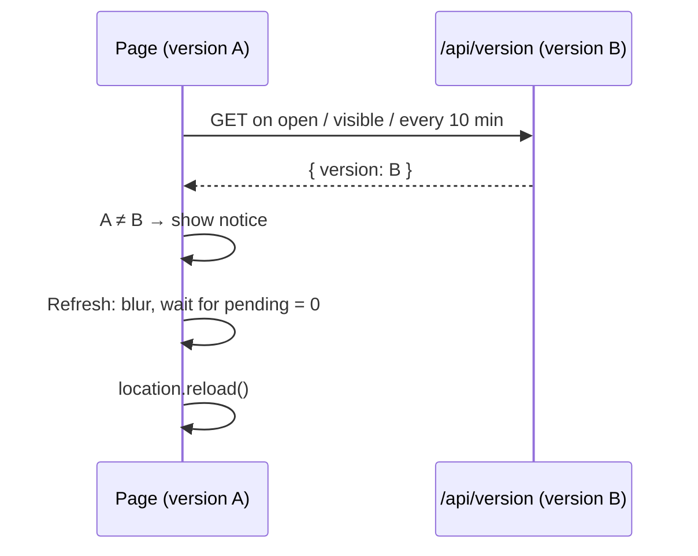

# Plan: SPEC-0008 Tell people when a new version is out

| Field  | Value                |
| ------ | -------------------- |
| Spec   | [spec.md](./spec.md) |
| ADR    | none (Tier 1)        |
| Status | draft                |

## 1. Approach

**Version identity.** At build time `next.config.ts` sets a public constant `NEXT_PUBLIC_APP_VERSION` to the commit being built: `GITHUB_SHA` (set by GitHub Actions, where `vercel build` runs) or else `VERCEL_GIT_COMMIT_SHA`, or else `"dev"`. It is inlined into both the client bundle and the server build. A rollback promotes an older prebuilt deployment with its own, older value, so REQ-0008-03 holds without extra work. No workflow or CI change is needed. The commit id isn't a secret, so the `NEXT_PUBLIC_` prefix is fine.

**Check.** A new route, `GET /api/version`, answers `{ "version": "<sha>" }` with `Cache-Control: no-store`. It takes no input, uses no store, and has its own per-instance limiter. A hook, `useNewVersion()`, asks on mount, on `visibilitychange` to visible, and every 10 minutes while visible. It parses the answer with Zod and reports `available` when the value differs from the page's own. `"dev"` on either side never counts. Failures are ignored until the next check (REQ-0008-04).

**Notice.** `VersionNotice` (UI, props only) renders a slim bar as a new `notice` slot inside `ActionBar`, above the buttons, so it never covers controls or pushes the title (REQ-0008-07). The text is announced through the page's existing live region. It has one **Refresh** button and no dismiss control (REQ-0008-08). It is mounted by the solo app, the shared game app, and the "not available" page.

**Refreshing safely.** `Refresh` first blurs the focused element, so a `DraftInput` commits its text (REQ-0008-11). On a solo page it then reloads; the game and step are already saved. On a shared page:

- If `pending === 0`, it reloads.
- If edits are pending and the device is live, it shows "Saving your changes…" and reloads when `pending` reaches 0 (REQ-0008-10).
- If offline, it shows the confirm described in §5 (proposed amendment).

**Old versions that can no longer edit (REQ-0008-13).** `lib/shared-game.ts` gains `EDIT_PROTOCOL` (starts at 1) and `MIN_EDIT_PROTOCOL` (starts at 1). The edit envelope gets an optional `protocol` field; a missing field means 1, so pages from before this change keep working. When a later change raises `MIN_EDIT_PROTOCOL`, the actions route answers `409` with type `outdated_client` for older envelopes. `sendEdit` maps that to `{ kind: "outdated" }`. `useSharedEditor` then stops sending, keeps the queue, and exposes `outdated: true`, which turns the notice into "Refresh to keep editing". The queue is mirrored to `sessionStorage` per game, so it survives the reload. The new version re-validates each kept action with `SharedActionSchema`, sends the valid ones, and drops the rest with the existing "wasn't saved" reason.

## 2. Constitution check

| Invariant group           | Complies? | Notes                                                                                                                                                     |
| ------------------------- | --------- | --------------------------------------------------------------------------------------------------------------------------------------------------------- |
| Governance (01–03, 16–18) | Yes       | Spec approved before code; the new route and refusal type are ask-first API changes, approved with the spec; tests cite REQ-0008 ids.                     |
| Architecture (04–07)      | Yes       | Notice is a presentational component; the check is a hook in the routes layer; the fetch lives in `lib/infra/`; the route follows `docs/API_PATTERNS.md`. |
| Security (08–11)          | Yes       | The route takes no input, returns a public value in a fixed shape, is same-origin and rate-limited. CSP is unchanged. No secret in `NEXT_PUBLIC_`.        |
| Quality (12–15)           | Yes       | Unit, component, e2e, visual and a11y tests; Lighthouse ≥ 90 kept (a small component and one small request).                                              |

## 3. Design

- **Layers touched:** `lib/` (version compare, protocol constants), `lib/infra/` (version client, pending-edit storage), `app/api/version/` (new route), `app/api/games/[id]/actions/` (protocol check), `app/` (hook, three page components), `app/components/` (`VersionNotice`, `ActionBar` slot).
- **Files and modules:**
  - `next.config.ts`: `env: { NEXT_PUBLIC_APP_VERSION: … }`.
  - New `lib/app-version.ts`: `APP_VERSION`, `isDifferentVersion(a, b)` (false when either is `"dev"`).
  - New `app/api/version/route.ts`: GET only, `no-store`, limiter, generic errors.
  - New `lib/infra/version-client.ts`: `fetchVersion()` with Zod `{ version: string(1–64) }`.
  - New `app/useNewVersion.ts`: the timing above, reusing the visibility pattern from `useSharedGame`.
  - New `app/components/VersionNotice.tsx` and `docs/components/VersionNotice.md`.
  - `app/components/ActionBar.tsx`: optional `notice` slot above the buttons.
  - `app/ChipLedgerApp.tsx` and `app/SharedGameApp.tsx` (including its "not available" state, which renders `GameUnavailable`): mount the notice; `GameUnavailable` takes it as a prop so UI stays free of I/O.
  - `lib/shared-game.ts`: `EDIT_PROTOCOL`, `MIN_EDIT_PROTOCOL`, envelope `protocol: z.number().int().min(1).optional()`.
  - `app/api/games/[id]/actions/route.ts`: `outdated_client` refusal.
  - `lib/infra/shared-game-client.ts`: `outdated` outcome. `app/useSharedEditor.ts`: pause state, `sessionStorage` mirror via new `lib/infra/pending-edits-storage.ts` (Zod-parsed, try/catch, no keys stored).
- **Data model and contracts:**
  - `GET /api/version` → `200 { version: string }`; `429` problem body with `Retry-After`.
  - Edit envelope: optional `protocol: number`. New problem type `outdated_client` (409).
  - `sessionStorage["chip-ledger.pending.v1:<gameId>"]`: array of `{ actionId, action, queuedAt }`.
- **Control flow:**

## 4. Testing strategy

| Requirement      | Unit                                          | Component                         | E2E                                                    | Visual       | A11y             |
| ---------------- | --------------------------------------------- | --------------------------------- | ------------------------------------------------------ | ------------ | ---------------- |
| REQ-0008-01, -02 | hook timing with fake timers                  |                                   | AC-0008-01, -03 (route mocked with `page.route`)       |              |                  |
| REQ-0008-03      | `isDifferentVersion` incl. `"dev"`            |                                   | AC-0008-04 (mock answers an older value)               |              |                  |
| REQ-0008-04, -05 | client parse failures                         | no notice on failure              | AC-0008-05 (offline, request log has no game data)     |              |                  |
| REQ-0008-06, -07 |                                               | VersionNotice; ActionBar slot     | AC-0008-10 (each step, shared, unavailable)            | notice, both | axe both, 320 px |
| REQ-0008-08      |                                               | no dismiss control                | AC-0008-12                                             |              |                  |
| REQ-0008-09, -11 |                                               | Refresh blurs the draft first     | AC-0008-06                                             |              |                  |
| REQ-0008-10      | useSharedEditor waits for pending             | "Saving your changes…" state      | AC-0008-07, -08                                        |              | announced        |
| REQ-0008-12      |                                               |                                   | AC-0008-09                                             |              |                  |
| REQ-0008-13      | envelope schema; route refusal; client map    | editor pauses and keeps the queue | AC-0008-11 (raise `MIN_EDIT_PROTOCOL` in a test build) |              |                  |
| Route            | route test: shape, `no-store`, limiter, error |                                   |                                                        |              |                  |

## 5. Risks and mitigations

| Risk                                                                                                                                                                                                                          | Likelihood | Impact | Mitigation                                                                                                                                                                                                                              |
| ----------------------------------------------------------------------------------------------------------------------------------------------------------------------------------------------------------------------------- | ---------- | ------ | --------------------------------------------------------------------------------------------------------------------------------------------------------------------------------------------------------------------------------------- |
| **Spec conflict, REQ-0008-10 offline case.** With no service worker, reloading while offline shows the browser's own offline page instead of the game. Confirming "lose the changes" still leaves the person without the app. | High       | Medium | **Proposed spec amendment for owner approval:** when offline, **Refresh** says "You're offline. Refresh when you're back online." and does not reload. Unsent edits are kept, also in `sessionStorage`. Not implemented until approved. |
| `GITHUB_SHA` isn't visible to `vercel build` in Actions, or a preview and production share a commit.                                                                                                                          | Low        | Medium | Task T-01 checks the value on a preview build first. The same commit means the same code, so no notice is correct.                                                                                                                      |
| The notice appears for a deploy that changed nothing visible (docs only).                                                                                                                                                     | High       | Low    | Accepted: same code is not guaranteed, and refresh is cheap and safe.                                                                                                                                                                   |
| An old page from before this change never shows the notice.                                                                                                                                                                   | Certain    | Low    | It gets the notice code on its next reload. This is a one-time gap.                                                                                                                                                                     |

## 6. Rollout and rollback

Direct release. `MIN_EDIT_PROTOCOL` stays at 1 in this change, so nothing is refused yet. Raising it later is part of whichever future change breaks edit compatibility, and is called out in that PR. Revert the PR to roll back. Revert is safe: old code ignores the extra `sessionStorage` key and the optional envelope field.

## 7. Documentation to update

- [ ] Reference docs: `docs/API_PATTERNS.md` (`/api/version`, `outdated_client`), `docs/ARCHITECTURE.md` (version check), `docs/DEPLOYMENT.md` (how the version is set; raising `MIN_EDIT_PROTOCOL`), `docs/ERROR_HANDLING.md` (new refusal)
- [ ] `sdd.yaml`: N/A unless the routes list is enumerated there (check during T-02)
- [ ] `.env.example` and `docs/CONFIGURATION.md`: `NEXT_PUBLIC_APP_VERSION` (build-time, derived, not set by hand)
- [ ] Component docs: `docs/components/VersionNotice.md`; `ActionBar` slot
